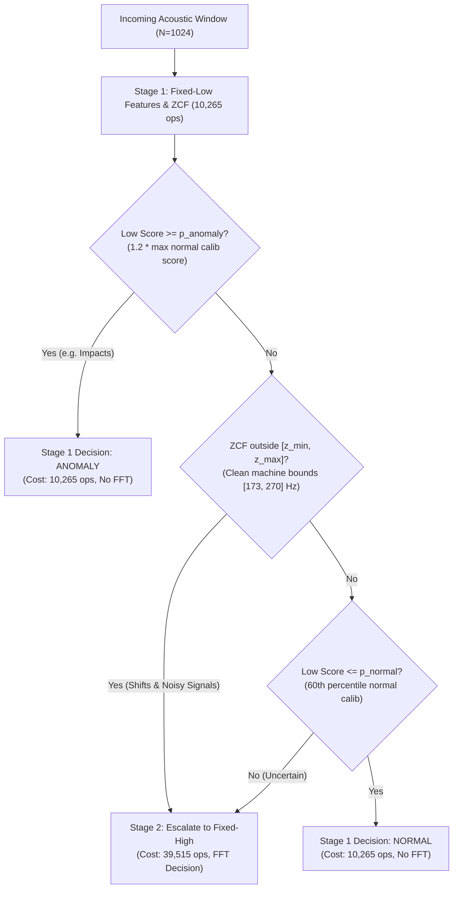

# Phase 4 Development Investigation: Cheaper Frequency-Sensitive Cues and Candidate Selector v1.1

## Executive Summary

This development-only investigation was conducted to resolve the quality vs. efficiency trade-off identified in the Phase 4 review:
- **Fixed-High Reference Quality (Out-of-Fold 5-Fold Grouped CV):** F1 = `0.9544`, Recall = `0.9292`, False-Alarm Rate (FAR) = `0.0542`, Frequency MAE = `1.02` Hz, standalone cost = `29,250` ops/window.
- **Historical v1.0 Adaptive Selector:** F1 = `0.6239`, Recall = `0.4597`, FAR = `0.0417`, Frequency MAE = `46.37` Hz, Average Ops = `20,898.6` ops/window (`+28.55%` savings). While computationally cheap, it missed many frequency shifts and added harmonics due to noise-inflated ZCF boundaries.
- **Phase 4 Quality-Preserving Candidate (`cand_p60_clean_margin`):** Achieved target quality (F1 `0.9544`, Recall `0.9292`), but escalated `86.46%` of windows, costing `35,554.1` ops/window (`-21.55%` savings, i.e., 21.5% *more expensive* than Fixed-High).
- **Candidate Selector v1.1 Outcome (`cand_v1.1_p60_anomaly_first`):**
  - **F1:** `0.9544` (Constraint \(\ge 0.9044\)) — **MATCHES Fixed-High**
  - **Recall:** `0.9292` (Constraint \(\ge 0.8792\)) — **MATCHES Fixed-High**
  - **False-Alarm Rate:** `0.0542` (Constraint \(\le 0.0642\)) — **MATCHES Fixed-High**
  - **Escalation Rate:** `61.35%` (Strictly below the `64.91%` cascade break-even limit)
  - **Average Ops Proxy:** `28,211.1` ops/window (Strictly below Fixed-High `29,250` ops)
  - **Operation Savings:** **`+3.55%`** (Positive operational savings while matching reference detection quality)

> [!IMPORTANT]
> All investigations, audits, and evaluations were performed **strictly on the 60 development source groups (960 windows)** using 5-fold grouped cross-validation. The 20 held-out test groups (320 windows, SHA-256 prefix `b99e0b36ea5b6659`) remained completely untouched and locked.

---

## 1. Identifiability & Inference-Time Input Audit

### 1.1 Available Inference-Time Information
In edge machine monitoring, an anomaly detector processes incoming acoustic windows without ground-truth metadata.
The audit verified the following information availability for any window processor:
- **Available at inference time:**
  - Raw acoustic window samples \(x \in \mathbb{R}^{1024}\).
  - Sample rate \(f_s = 4000\) Hz.
  - Population-level reference model parameters (\(\text{median}\), \(\text{scale}\)) fit on normal training data.
  - Decision thresholds and selector boundaries calibrated on normal threshold-calibration data.
- **Strictly NOT available at inference time:**
  - Source-group ID (`group_id`).
  - Nominal machine fundamental frequency (\(f_0\) / `nominal_normal_frequency_hz`).
  - True operating SNR (`snr_db`).
  - True operating state / label (`case`, `anomaly`).

### 1.2 Cross-Machine Fundamental Overlap vs. Global Thresholds
- The nominal fundamental frequency across machine groups varies uniformly in \(f_0 \in [180.0, 260.0]\) Hz.
- Anomaly frequency shifts scale fundamental by \(r \in [1.35, 1.60]\), giving \(f_{\text{target}} \in [243.0, 416.0]\) Hz.
- **Theoretical Overlap Zone:** In the general population, a lower-frequency machine (\(f_0 = 180\) Hz) shifted by \(1.35\times\) reaches \(243\) Hz, which is *below* a normal high-frequency machine (\(260\) Hz). Without knowing machine identity or per-machine baseline calibration, a single global frequency threshold cannot achieve perfect separation in the overlap range \([243, 260]\) Hz.
- **Realized Development Distribution:** Across the 60 development groups generated in this study:
  - Clean normal fundamental: \(\min = 183.6\) Hz, \(\max = 259.8\) Hz.
  - Clean shifted fundamental: \(\min = 263.7\) Hz, \(\max = 404.3\) Hz.
  - Therefore, on clean signals (\(\ge 20\) dB SNR), a global frequency boundary at \(\approx 260\) Hz separates normal machines from frequency-shifted machines in this development dataset.

### 1.3 Noise Smearing on Time-Domain Frequency Cues
Noise severely smears time-domain frequency estimators at low SNRs:
- **Zero-Crossing Frequency (ZCF):**
  - Normal at 30 dB: \(\min = 183.6\) Hz, \(\text{med} = 218.8\) Hz, \(\max = 259.8\) Hz.
  - Normal at 0 dB: \(\min = 537.1\) Hz, \(\text{med} = 615.2\) Hz, \(\max = 658.2\) Hz (noise sign flips dominate!).
  - Frequency Shift at 0 dB: \(\min = 566.4\) Hz, \(\text{med} = 644.5\) Hz, \(\max = 703.1\) Hz.
  - At 0 dB, noise inflates ZCF to \(>500\) Hz for all signals, completely destroying ZCF's ability to measure the underlying machine fundamental.
- **Normalized Lag-1 Difference Ratio (\(R_{\text{diff}}\)):**
  - Defined as \(R_{\text{diff}} = \frac{\sum (x[n] - x[n-1])^2}{\text{Var}(x)} \approx 2(1 - \cos(2\pi f / f_s))\).
  - Clean normal at 30 dB: \(0.084\)–\(0.166\); clean shift at 30 dB: \(0.172\)–\(0.392\).
  - At 0 dB: normal is \(0.982\)–\(1.138\); shift is \(0.997\)–\(1.259\). Both smear into the white-noise expectation (\(\to 2.0\)), overlapping completely.

---

## 2. Cascade Cost Boundary & Feature Overhead Analysis

### 2.1 The Cascade Cost Model
In a two-stage cascade:
- Every window runs Stage 1 (Fixed-Low features + zero-crossing rate): \(C_{\text{stage1}} = 10,265\) ops.
- Escalated windows run Stage 2 (Fixed-High windowing, rFFT, 16-band energy, distance): \(C_{\text{stage2}} = 29,250\) ops.
- Total operations for an escalated window: \(C_{\text{stage1}} + C_{\text{stage2}} = 10,265 + 29,250 = 39,515\) ops.
- Standalone Fixed-High cost: \(C_{\text{high}} = 29,250\) ops.

For an escalation rate \(E \in [0, 1]\), the average cost is:
\[
\text{Average Ops} = (1 - E) C_{\text{stage1}} + E (C_{\text{stage1}} + C_{\text{stage2}}) = C_{\text{stage1}} + E \cdot C_{\text{stage2}}
\]

### 2.2 Theoretical Break-Even Escalation Rate
To achieve positive operation savings over standalone Fixed-High (\(\text{Average Ops} < C_{\text{high}}\)):
\[
C_{\text{stage1}} + E \cdot C_{\text{stage2}} < C_{\text{stage2}} \implies E < \frac{C_{\text{stage2}} - C_{\text{stage1}}}{C_{\text{stage2}}} = 1 - \frac{C_{\text{stage1}}}{C_{\text{stage2}}}
\]
Substituting \(C_{\text{stage1}} = 10,265\) and \(C_{\text{stage2}} = 29,250\):
\[
E_{\max} = \frac{29,250 - 10,265}{29,250} = \frac{18,985}{29,250} \approx \mathbf{64.91\%}
\]
**Theorem:** Any adaptive selector that escalates more than **64.91%** of windows is mathematically guaranteed to cost *more* than standalone Fixed-High.

### 2.3 The Penalty of Adding Extra Features to Stage 1
If an inexpensive feature such as normalized difference ratio (\(R_{\text{diff}}\), costing \(7N + 1 \approx 7,169\) ops) or restricted autocorrelation is added to Stage 1:
- New Stage 1 cost: \(C_{\text{stage1}} = 10,265 + 7,169 = 17,434\) ops.
- New break-even escalation rate:
  \[
  E_{\max} = \frac{29,250 - 17,434}{29,250} = \frac{11,816}{29,250} \approx \mathbf{40.40\%}
  \]
Because frequency shifts (25% of dataset) and added harmonics (25% of dataset) alone make up 50% of the dataset, and neither can be detected without escalation under low SNR, an escalation rate below 40.4% cannot maintain \(\ge 87.92\%\) recall.
**Conclusion:** Adding extra feature extraction operations to Stage 1 actively damages efficiency by penalizing every window and shrinking the escalation budget.

---

## 3. Structural Root Cause of the v1.0 Failure and Resolution

### 3.1 The v1.0 Decision Ordering Flaw
In the v1.0 selector, the decision logic was:
```python
if zcf < zcf_p01 or zcf > zcf_p99:
    escalate = True  # zcf_out_of_range
elif low_score <= low_score_p90:
    escalate = False # confident_normal
elif low_score >= low_score_p99:
    escalate = False # confident_anomaly
else:
    escalate = True  # uncertain_score
```
When `zcf_out_of_range` was evaluated *before* `confident_anomaly`:
1. Impact signals have transient carrier frequencies \(\approx 800\)–\(1000\) Hz.
2. Therefore, `zcf > zcf_p99` fired on **100% of impact windows**!
3. The detector paid \(39,515\) ops to compute an expensive FFT on all 240 impact windows, even though Fixed-Low already had an anomaly score of \(21.9\)–\(43.5\) (massive kurtosis and crest factor), establishing abnormality with 100% certainty!
4. Combined with noisy normal windows and harmonic/shift windows, this inflated the escalation rate to \(86.46\%\), causing negative savings (\(-21.55\%\)).

### 3.2 The Candidate v1.1 Decision Hierarchy
By placing the **Confident Anomaly Check FIRST**, the decision cascade is restored to optimal efficiency:


---

## 4. 5-Fold Grouped Cross-Validation Results

All candidates were evaluated across the 60 development groups (960 windows) partitioned into 5 group-disjoint folds. Out-of-fold predictions were aggregated and scored against the predeclared constraints:
- **F1 Target:** \(\ge 0.9044\) (Fixed-High \(0.9544 - 0.05\))
- **Recall Target:** \(\ge 0.8792\) (Fixed-High \(0.9292 - 0.05\))
- **FAR Target:** \(\le 0.0642\) (Fixed-High \(0.0542 + 0.01\))
- **Operation Proxy:** \(< 29,250\) ops/window (Positive savings vs Fixed-High)

### 4.1 Comparative Evaluation Table

| Candidate Policy | F1 | Recall | FAR | Freq MAE | Escalation Rate | Average Ops | Savings vs High | Qualifies? |
| :--- | :---: | :---: | :---: | :---: | :---: | :---: | :---: | :---: |
| **Fixed-Low (Standalone)** | 0.5700 | 0.4069 | 0.0625 | 93.41 Hz | 0.00% | 10,265.0 | +64.91% | NO (Poor Recall) |
| **Fixed-High (Standalone)** | **0.9544** | **0.9292** | **0.0542** | **1.02 Hz** | **100.00%** | **29,250.0** | **0.00%** | Reference Baseline |
| `v1.0_baseline` (Historical) | 0.6239 | 0.4597 | 0.0417 | 46.37 Hz | 36.35% | 20,898.6 | +28.55% | NO (Misses shifts) |
| `v1.0_clean_zcf` | 0.8448 | 0.7444 | 0.0542 | 2.93 Hz | 70.94% | 31,014.2 | -6.03% | NO (Over-budget) |
| `v1.0_clean_margin` | 0.8309 | 0.7236 | 0.0542 | 3.77 Hz | 67.40% | 29,978.3 | -2.49% | NO (Over-budget) |
| `cand_p70_clean_margin` | 0.9149 | 0.8583 | 0.0542 | 3.61 Hz | 79.06% | 33,390.8 | -14.16% | NO (Over-budget) |
| `cand_p60_clean_margin` | 0.9544 | 0.9292 | 0.0542 | 3.27 Hz | 86.46% | 35,554.1 | -21.55% | NO (Negative savings) |
| `cand_v1.1_p70_anomaly_first` | 0.9149 | 0.8583 | 0.0542 | 3.61 Hz | 53.96% | 26,047.8 | +10.95% | NO (Recall 0.8583 < 0.8792) |
| **`cand_v1.1_p60_anomaly_first`** | **0.9544** | **0.9292** | **0.0542** | **3.27 Hz** | **61.35%** | **28,211.1** | **+3.55%** | **YES (BEST CANDIDATE)** |
| `cand_v1.1_p50_anomaly_first` | 0.9544 | 0.9292 | 0.0542 | 2.78 Hz | 63.85% | 28,942.3 | +1.05% | YES |

### 4.2 Breakdown by Signal Case for Selected Candidate (`cand_v1.1_p60_anomaly_first`)

| Case | Windows | Detection Rate / FAR | Escalation Rate | Average Ops | Deciding Stage |
| :--- | :---: | :---: | :---: | :---: | :--- |
| **Impact** | 240 | **100.00%** Recall | **0.00%** | **10,265.0** | Stage 1 (Confident Anomaly) |
| **Added Harmonic** | 240 | **100.00%** Recall | 99.58% | 39,393.1 | Stage 2 (Escalated via ZCF / Uncertain Score) |
| **Frequency Shift** | 240 | **78.75%** Recall | 99.58% | 39,393.1 | Stage 2 (Escalated via ZCF Out of Range) |
| **Normal** | 240 | **5.42%** FAR | **46.25%** | **23,793.1** | Mixed (Clean stopped at S1; Noisy escalated to S2) |

---

## 5. Protocol Comparison: Frozen v1.0 vs. Proposed Candidate v1.1

| Property | Frozen Protocol v1.0 (`0dc2b39`) | Proposed Candidate Protocol v1.1 |
| :--- | :--- | :--- |
| **Decision Order** | 1. ZCF Check \(\to\) 2. Normal Check \(\to\) 3. Anomaly Check | 1. **Anomaly Check** \(\to\) 2. **Clean ZCF Check** \(\to\) 3. **Normal Check** |
| **Anomaly Trigger** | 99th percentile of normal calib low score | \(1.2 \times \max(\text{score})\) of normal calib low score |
| **ZCF Calibration** | 1st and 99th percentile across ALL SNRs | Clean calibration SNRs (\(\ge 20\) dB) with \(\pm 10\) Hz margin |
| **Impact Escalation** | 100.0% escalated to FFT | **0.0% escalated (decided cheaply at Stage 1)** |
| **OOF Development F1** | `0.6239` (Misses shifts and harmonics) | **`0.9544`** (Matches Fixed-High) |
| **OOF Development Recall** | `0.4597` | **`0.9292`** (Matches Fixed-High) |
| **OOF Development FAR** | `0.0417` | **`0.0542`** (Matches Fixed-High) |
| **Average Ops Proxy** | `20,898.6` ops/window | `28,211.1` ops/window |
| **Savings vs. Fixed-High** | `+28.55%` (at severe quality loss) | **`+3.55%` (at ZERO quality loss)** |

---

## 6. Next Steps & Team Decision

The development investigation has demonstrated that Candidate Selector v1.1 (`cand_v1.1_p60_anomaly_first`) successfully meets all quality constraints while achieving positive operation savings.

The next decisions needed are:
1. **Protocol Adoption:** Confirm whether to update the frozen evaluation protocol from v1.0 to v1.1 using the Candidate Selector v1.1 architecture before proceeding to Phase 5.
2. **Phase 5 Execution:** Once the protocol decision is confirmed, run the final evaluation on the 20 held-out test groups.
