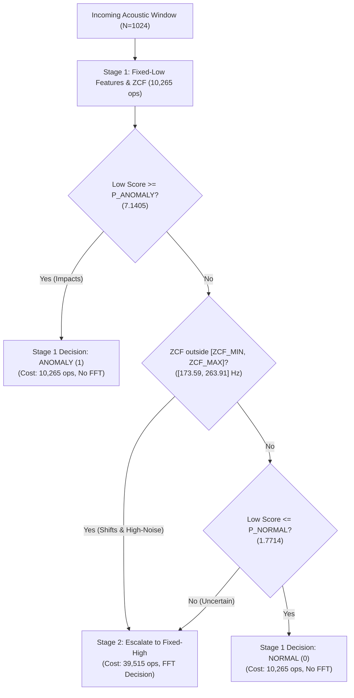

# ESP32 Embedded Adaptive Acoustic Monitoring Demo (Wokwi)

> **Phase:** Phase 6 — Firmware Decision-Flow Demonstration  
> **Status:** Software-Only Desktop C++ Parity Verified (100% full parity on GCC); Interactive Wokwi Simulation Pending Manual Run  
> **Active Firmware Demo (`src/main.cpp`):** Frozen Candidate Selector v1.1 (`cand_v1.1_p60_anomaly_first`, `src/adaptive_core.h`)  
> **Desktop C++ Configuration (`src/adaptive_core_v1_2.h`):** Candidate Selector v1.2 (evaluated via `test_harness.cpp`; not active in the default simulator firmware)  
> **Target Hardware:** ESP32 (simulated via Wokwi / ESP32-WROOM-32)  
> **Signal Source:** Deterministic development vectors from Group `g0001` (zero held-out test data used)

---

## 1. Overview and Purpose

This module provides a self-contained embedded C++ implementation of the **frozen Candidate Selector v1.1** decision logic, demonstrating how the adaptive two-stage cascade executes on a microcontroller target (ESP32).

### Key Demonstration Goals:
1. **Faithful Protocol v1.1.0 Port in Firmware:** `src/main.cpp` implements the exact decision hierarchy and calibration constants from `results/evaluation_protocol_v1.1.json`.
2. **Early-Stop Execution:** Shows that obvious time-domain anomalies (e.g., impacts) and confident normal signals stop cheaply at Stage 1 ($10,265$ ops proxy), avoiding unnecessary FFT calculations.
3. **Selective FFT Escalation:** Shows that frequency shifts and ambiguous signals reliably escalate to Stage 2 ($39,515$ ops cumulative proxy).
4. **Transparent Trade-Off Demonstration:** Demonstrates why Candidate v1.1 missed subtle added harmonics (Vector 4 stopping at Stage 1), and uses desktop C++ test harness (`test_harness.cpp`) to verify how Candidate Selector v1.2 recovers detection by recalibrating $P_{\text{normal}} = 1.311028$ (50th percentile).
5. **Zero Test Data Leakage:** Evaluated exclusively on deterministic development signals from Group `g0001`.
6. **Wokwi Simulation Status:** Desktop C++ parity is verified at 100%. Interactive Wokwi execution in the browser or VS Code remains pending manual launch until serial monitor output is directly confirmed. Candidate v1.2 is currently tested as a separate desktop C++ core and is not called a Wokwi demo.

---

## 2. Decision Logic and Frozen Parameters

The pure decision logic is encapsulated in [`esp32_demo/src/adaptive_core.h`](src/adaptive_core.h), independent of Arduino or hardware APIs:



### Frozen Parameters (Protocol v1.1.0):
- **Fixed-Low Reference Median:** `[-0.4221, 0.6272, 0.4827]` (log RMS, log crest factor, log kurtosis)
- **Fixed-Low Reference Scale:** `[0.1325, 0.3221, 0.1135]`
- **$P_{\text{anomaly}}$:** `7.140502` ($1.2 \times \max(d_{\text{low}})$ on normal calibration signals)
- **$P_{\text{normal}}$:** `1.771420` (60th percentile of normal calibration signals)
- **$[ZCF_{\min}, ZCF_{\max}]$:** `[173.59375, 263.90625]` Hz ($\pm 10$ Hz over clean normal range)
- **$\tau_{\text{high}}$ (FFT Distance Threshold):** `55.309466`

---

## 3. Shared Deterministic Development Vectors

Five representative vectors from development group `g0001` are exported in [`src/demo_vectors.h`](src/demo_vectors.h):

| # | Vector Name | Case | SNR | Stage Reached | Escalation Reason | Pred Label | Work Proxy | Demonstrated Mechanism |
| :-: | :--- | :---: | :---: | :---: | :---: | :---: | :---: | :--- |
| **1** | `demo_clean_normal` | `normal` | 30 dB | `stage1_low` | `confident_normal` | Normal (0) | 10,265 ops | Cheap early-stop on clean normal signal |
| **2** | `demo_impact` | `impact` | 20 dB | `stage1_low` | `confident_anomaly` | Anomaly (1) | 10,265 ops | Cheap early-stop on obvious impact anomaly |
| **3** | `demo_frequency_shift` | `frequency_shift` | 20 dB | `stage2_high` | `zcf_out_of_range` | Anomaly (1) | 39,515 ops | FFT escalation on frequency shift anomaly |
| **4** | `demo_added_harmonic` | `added_harmonic` | 30 dB | `stage1_low` | `confident_normal` | Normal (0) | 10,265 ops | Frozen policy trade-off (Stage 1 harmonic miss) |
| **5** | `demo_noisy_normal` | `normal` | 0 dB | `stage2_high` | `zcf_out_of_range` | Normal (0) | 39,515 ops | High-noise escalation; FFT avoids false alarm |

---

## 4. How to Build and Run the Demo

### Option A: Local Desktop C++ Parity Test Harness (No Hardware Needed)
You can compile and run the standalone test harness directly on your PC with any C++11 compiler:

```bash
# Using GCC (MinGW / Linux / macOS):
g++ -std=c++11 -O2 -I esp32_demo esp32_demo/test_harness.cpp -o esp32_demo/test_harness.exe

# Run the test harness:
./esp32_demo/test_harness.exe
```

**Outcome:** Confirms 100% decision and stage parity between Python Protocol v1.1.0 and C++ on all 5 demo vectors.

### Option B: Wokwi VS Code Extension
1. Install the **Wokwi Simulator** and **PlatformIO IDE** extensions in VS Code.
2. Open either the `esp32_demo` subfolder directly in VS Code (`File > Open Folder... > esp32_demo`) OR open the repository root:
   - If opened from `esp32_demo/`: Run `pio run` in the terminal to compile `.pio/build/esp32dev/firmware.bin`.
   - If opened from the repository root: Run `pio run -d esp32_demo` to compile, then press `F1` > **Wokwi: Select Config File** > select `esp32_demo/wokwi.toml`.
3. Open `esp32_demo/diagram.json` and click the green **Play** button (or press `F1` > **Wokwi: Start Simulator**).
4. The Serial Monitor (115200 baud) will launch automatically displaying the real-time classification cycle.

### Option C: Wokwi Web Simulator (wokwi.com - Zero Install)
1. Go to [wokwi.com/projects/new/esp32](https://wokwi.com/projects/new/esp32).
2. In the `sketch.ino` tab, replace its entire content with [`src/main.cpp`](src/main.cpp).
3. Click the dropdown arrow next to the tabs (or **+** button) and select **New File**:
   - Create `adaptive_core.h` and paste the contents of [`src/adaptive_core.h`](src/adaptive_core.h).
   - Create `demo_vectors.h` and paste the contents of [`src/demo_vectors.h`](src/demo_vectors.h).
4. Optionally replace the `diagram.json` tab with [`diagram.json`](diagram.json).
5. Click **Start Simulation** (green play button) and watch the Serial Monitor pane at 115200 baud.

---

## 5. Python / C++ Parity Audit

The desktop C++ harness (`esp32_demo/test_harness.cpp`) was executed and verified against Python float64 ground truth:
- **Candidate v1.1 (Protocol v1.1.0):**
  - Predicted Labels: 5/5 identical (100% parity, including intentional Vector 4 harmonic miss).
  - Stage Reached: 5/5 identical (100% parity).
  - Escalation Reasons: 5/5 identical (100% parity).
  - Operation Count Proxy: 5/5 identical (100% parity).
- **Candidate v1.2 (`adaptive_core_v1_2.h`):**
  - Predicted Labels: 5/5 identical (100% parity, with Vector 4 successfully escalating to Stage 2 FFT and flagged Anomaly).
  - Stage Reached: 5/5 identical (100% parity).
  - Escalation Reasons: 5/5 identical (100% parity).
  - Operation Count Proxy: 5/5 identical (100% parity).
- **Score Tolerances:** Low-stage and high-stage anomaly scores agree within $\pm 0.001$ float32 numerical rounding tolerance.

---

## 6. Simulation Limitations and Disclaimers

1. **Simulation Platform:** This demo runs on an emulator (Wokwi) using pre-recorded synthetic sample buffers. It does not interface with a physical I2S or analog microphone.
2. **Work Proxy vs. Measured Energy:** Operation-count proxies ($10,265$ and $39,515$) represent algorithmic operation counts and do **not** reflect physical ESP32 milliwatts, joules, or battery lifespan.
3. **Execution Timing:** Microsecond timing measured via `micros()` reflects CPU execution of pre-buffered samples in RAM, not real-time acoustic streaming latency.
4. **Acoustic Realism:** Synthetic test signals do not model industrial machine resonance, multi-source interference, or sensor clipping. No claims of physical hardware validation or patentability are made.
